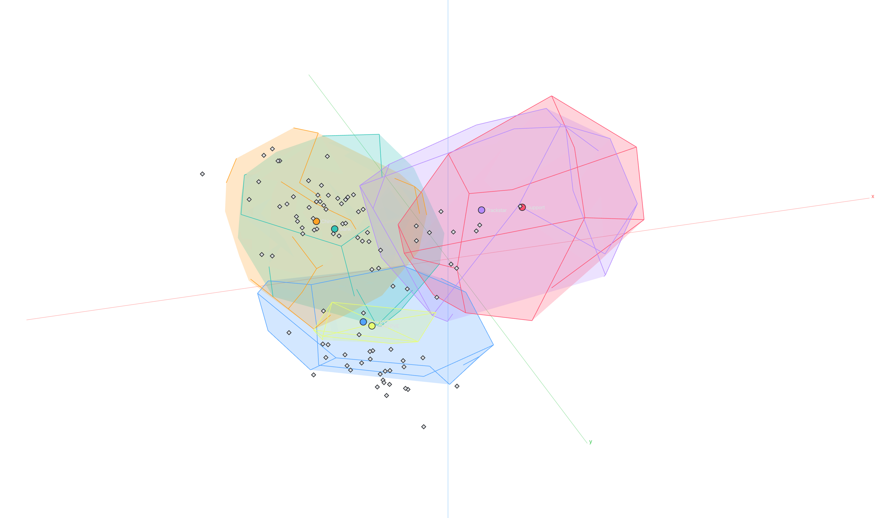

  <h1>tri</h1>
  
    
  

tri is a backend learning engine for Deepwoken talent and mantra selection. It can analyse a build , completes a partial build, and learns from expert reviews.

This is part of a larger project to mathematically understand the practice of Deepwoken building. This is a varied discipline, but the largest centralized generally accepted notion of "building" breaks the art into the **selection of mantras and talents**, **optimization of character stats**, and the **development of a concept**. Stat allocation is a solved problem, but talent/mantra selection has historically been understood as unsolvable.

There is some valid dogma behind this. Automatic talent selection is a problem that is identical to automatically upkeeping a build library, which no builder has managed to do over an extended period of time. A library needs maintainence because every patch, new talent and shift in the meta has to be carried into every build by hand, which is a chore.

tri (the human one) hypothesizes, from experience, that talent selection is actually a highly structured procedure that rigorously follows a set of rules that builders will have internalized after some time building. the problem is that there are 700+ talents to take, and each talent naturally has many builds leading into it. it is difficult for builders to conjure this ruleset intuitively much less to articulate it.

while a builder might memorize a rule like "overworld ganking builds always take replenishing knockout", the quantification of the archetype of the build, in this case being overworld ganking, is very difficult to automatically determine. common approaches to this solution discretizes the archetype, which we feel is enforcing too much structure onto conceptual building. the main point of interest tri raises is the concept space, which is used as additional context in ruleset reconstruction.

another issue is that while the selection of foundational and conceptuall central talents is formulaic, the worth of luxury talents is volatile and highly build dependent, which is why tri uses a second space, the worth space, which encodes the "worth" of cards in reference to the build that it is on as additional context in filling out talent slots.

## Interpretability

For the concept space projection:

- **What the dots are.** Every dot is one build. tri fits a model that predicts, for every talent and mantra, how likely a build like this one is to take it. The map is built so that the distance between two dots is how differently the model values items for them. Two builds at the same spot would be pushed to the same picks.

- **What the axes are.** The full concept space has many dimensions. The three axes shown are the directions with the most variance, a PCA projection. Think of a football, the length carries the most variance, so it is PCA1; the height and width carry less, so they are PCA2 and PCA3.

- **What the axes mean for Deepwoken.** On the run these notes were written against, PCA1 carried 43% of the variance (high end: picks like Exoskeleton; low end: picks like Spark Swap), PCA2 12% (Exhaustion Strike against Conquer Your Fears) and PCA3 6% (Crystal Path against Spark Revenge). The numbers and the items at each end change from run to run; tri reports them for the run it loads.

- **Archetypes.** PCA1 and PCA2 mostly decide a build's archetype. PCA3 mostly describes intraconceptual variation.

- **Pom conventions plane.** If you plot out the concept map, you may notice that all "conventional" pvp builds lie on a plane. This plane is the PCA1-2 plane, which is projected in the archetype atlas plot. This plane represents "standard" talent picking ruleset for pvp builds, where vertical deviance (PCA3) is the variation from conventional builds.

- **Mixed region 0** A region with no distinctive picks is named "mixed" and gets no archetype label. A mixed region far down PCA1 and far out on PCA3 (low on the standard picks, high on the nonstandard ones) usually holds builds that either have no coherent concept or were never really picked through.

## Docs

Start at [docs/Home.md](docs/Home.md): [plain words](docs/plain/README.md), [code](docs/code/layout.md), [math](docs/math/README.md), [learning prompt](docs/learn/prompt.md).

## Acknowledgements

- Talent and mantra requirements from [pocamind/data](https://github.com/pocamind/data).
- The reviewer team.
- TriTheGuy (namesake + system design)
